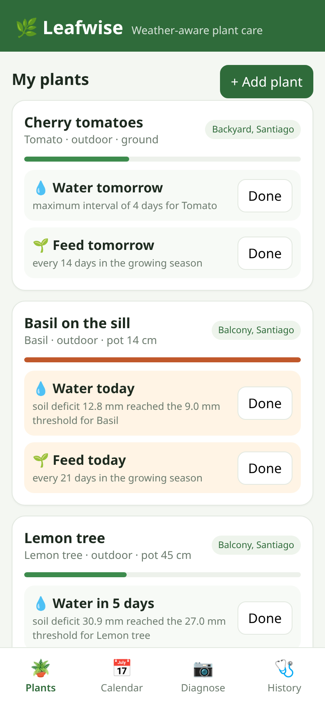
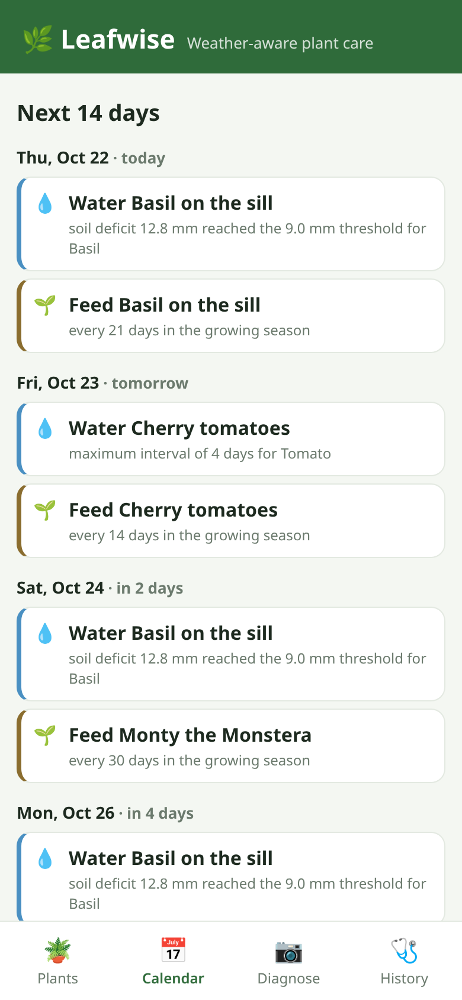
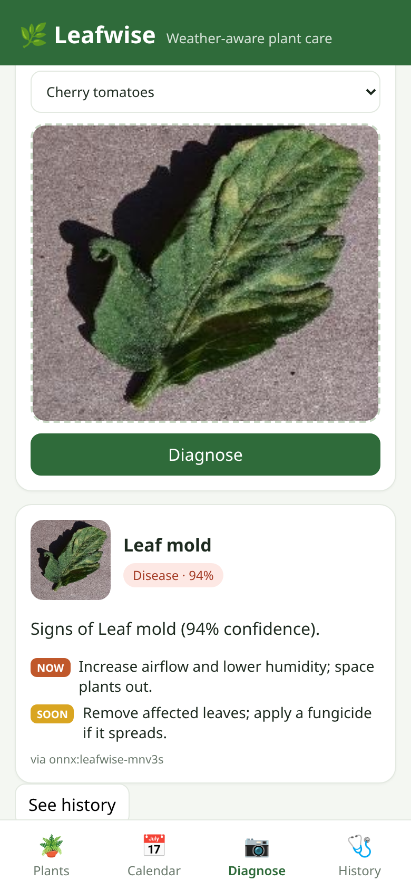
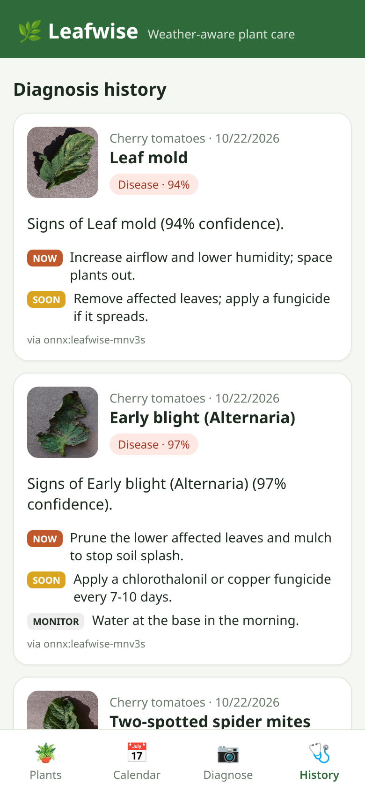
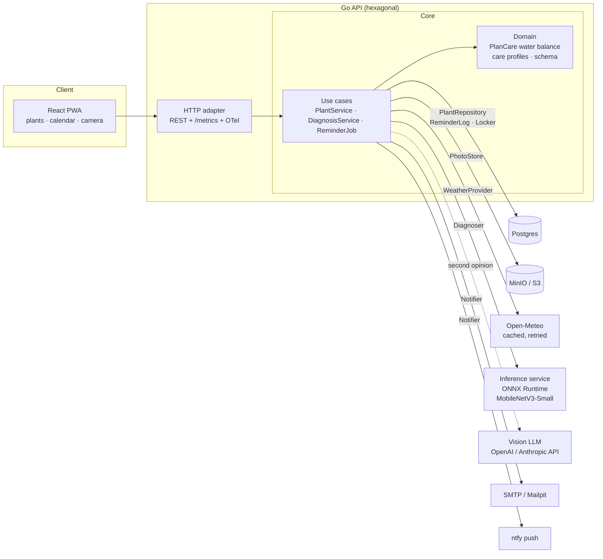
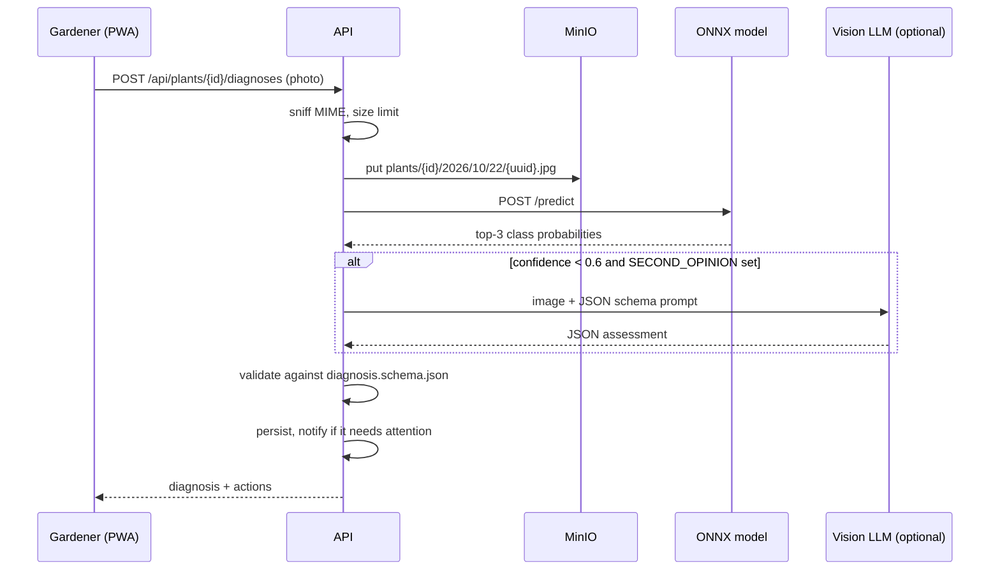
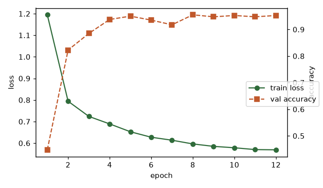

# 🌿 Leafwise

**A smart gardening assistant: weather-aware watering and feeding reminders, plus photo diagnosis of leaf diseases with a fine-tuned computer-vision model.**

[](https://github.com/ipenas-cl/leafwise/actions/workflows/ci.yml)


<p align="center">
  
  
  
  
</p>

## What it does

1. **Care scheduling that reads the weather.** You register plants (species, pot or ground, indoor or outdoor, location). Leafwise runs a daily soil water balance (simplified FAO-56) using **real Open-Meteo data**: reference evapotranspiration, rain and temperature, 14 days back and 7 ahead. A 14 cm basil pot in a heat wave is due tomorrow; the lavender bed after a storm can wait two weeks. Every recommendation has a reason, such as *"soil deficit 15.2 mm reached the 15.0 mm threshold for Basil"*.
2. **Fertilizing that knows the season.** It feeds only in the growing season of your hemisphere (September to March in Chile), at half rate in winter for heavy feeders like citrus, and never right before 10+ mm of rain.
3. **Reminders that never spam.** A background scheduler emails you (SMTP) and/or pushes (ntfy-compatible) once per task and due date, even with several replicas running.
4. **Photo diagnosis with a real model.** Snap a leaf and a **MobileNetV3-Small fine-tuned on PlantVillage** (10 tomato classes: blights, leaf spots, mould, viruses, spider mites, healthy) classifies it via **ONNX Runtime**. You get a schema-validated JSON diagnosis with confidence and recommended actions. When the model is unsure, an optional **vision LLM second opinion** (OpenAI- or Anthropic-compatible) is merged in.

## Architecture





| Layer | Path | Notes |
|---|---|---|
| Domain | `internal/domain` | `PlanCare` (pure, deterministic), care profiles for 12 species, diagnosis types |
| Ports | `internal/ports` | Repository, PhotoStore, WeatherProvider, **Diagnoser**, Notifier, Locker, Clock |
| Use cases | `internal/app` | Register and plan, calendar projection, diagnosis plus schema validation, reminder job |
| Adapters | `internal/adapters` | `postgres` (pgx, embedded migrations, advisory lock), `s3store` (minio-go), `openmeteo` (retry, TTL cache, stale-on-error), `diagnosis` (`onnx`, `llm`, `mock`, `SecondOpinion`), `notify` (SMTP, push, fan-out), `httpapi`, `telemetry` |
| ML | `ml/` | dataset download, training, evaluation, ONNX export, inference service, model card |
| Web | `web/` | React + Vite + TypeScript PWA (manifest, service worker, camera capture) |

Design decisions are recorded as ADRs in [`docs/adr`](docs/adr).

## The model

Test accuracy **94.2%**, macro-F1 **0.942** on 794 held-out images (2400 train / 400 val, 12 epochs).

| Class | Precision | Recall | F1 | Test images |
|---|---:|---:|---:|---:|
| Bacterial spot | 0.904 | 0.938 | 0.920 | 80 |
| Early blight | 0.985 | 0.812 | 0.890 | 80 |
| Late blight | 0.915 | 0.938 | 0.926 | 80 |
| Leaf Mold | 0.987 | 0.963 | 0.975 | 80 |
| Septoria leaf spot | 0.947 | 0.900 | 0.923 | 80 |
| Spider mites Two-spotted spider mite | 0.951 | 0.975 | 0.963 | 80 |
| Target Spot | 0.843 | 0.938 | 0.888 | 80 |
| Tomato Yellow Leaf Curl Virus | 0.975 | 0.963 | 0.969 | 80 |
| Tomato mosaic virus | 1.000 | 1.000 | 1.000 | 74 |
| healthy | 0.941 | 1.000 | 0.970 | 80 |

<p align="center">
  
  
</p>

- **Architecture:** MobileNetV3-Small with ImageNet weights. Blocks 0–8 are frozen; the last blocks and the head are fine-tuned with AdamW, a cosine LR schedule, label smoothing and colour/geometry augmentation. ~1.5M parameters, a ~6 MB ONNX file, ~10 ms per image on CPU.
- **Data:** a class-balanced subset of [PlantVillage](https://arxiv.org/abs/1511.08060) (tomato): 240 train, 40 val and up to 80 test images per class. The test images come from the dataset's separate test split.
- **Reproduce** in about 5 minutes on a laptop CPU:

  ```bash
  python -m venv .venv && . .venv/bin/activate
  pip install torch torchvision --index-url https://download.pytorch.org/whl/cpu
  pip install -r ml/requirements.txt
  cd ml && python download_dataset.py --out ../data/plantvillage --cache ../data/cache
  cd .. && python ml/train.py --data data/plantvillage --out ml/model --epochs 12
  python ml/report.py
  ```

- **Limits:** PlantVillage photos show single leaves on plain backgrounds, so accuracy on cluttered garden photos will be lower, and the model only knows tomato. The API says so in the diagnosis summary, and the LLM second opinion covers the rest. See the [model card](ml/MODEL_CARD.md).

## Quickstart (demo mode, no keys needed)

```bash
git clone https://github.com/ipenas-cl/leafwise && cd leafwise
docker compose up --build
```

| URL | What |
|---|---|
| http://localhost:3000 | The app (a demo garden in Santiago is seeded) |
| http://localhost:8080/metrics | Prometheus metrics |
| http://localhost:8000/metadata | Model server |
| http://localhost:8025 | Mailpit inbox: reminder emails show up here within a minute |
| http://localhost:9001 | MinIO console (`leafwise` / `leafwise-secret`): uploaded photos |

Try a diagnosis from the CLI with one of the sample leaves:

```bash
PLANT=$(curl -s localhost:8080/api/plants | jq -r '.[0].id')
curl -s -F photo=@ml/samples/Early_blight-1.jpg localhost:8080/api/plants/$PLANT/diagnoses | jq '.summary, .findings[0]'
```

### Configuration

| Variable | Default | Purpose |
|---|---|---|
| `DATABASE_URL` | *(memory)* | Postgres DSN. Migrations run on start |
| `S3_ENDPOINT`, `S3_ACCESS_KEY`, `S3_SECRET_KEY`, `S3_BUCKET` | *(memory)* | Any S3-compatible store |
| `INFERENCE_URL` | — | ONNX model server. Setting it makes `onnx` the default diagnoser |
| `DIAGNOSIS_PROVIDER` | `onnx` or `mock` | `onnx`, `mock`, `openai`, `anthropic` |
| `SECOND_OPINION` | — | `openai` or `anthropic`: asked when model confidence < 0.6 |
| `LLM_API_KEY`, `LLM_BASE_URL`, `LLM_MODEL` | — | Works with any OpenAI-compatible endpoint (Ollama, vLLM, Groq…) |
| `WEATHER_PROVIDER` | `openmeteo` | `static` for offline demos |
| `SMTP_ADDR`, `SMTP_FROM`, `PUSH_URL`, `PUSH_TOKEN` | — | Notification channels |
| `REMINDER_INTERVAL` | `15m` | Scheduler period |
| `OTEL_EXPORTER_OTLP_ENDPOINT` | — | Enables OTLP/HTTP trace export |

### Local development

```bash
go test ./...                       # domain, use cases, adapters, HTTP
LEAFWISE_TEST_DATABASE_URL=postgres://... go test ./internal/adapters/postgres   # integration
(cd ml/serve && pytest -q)          # model server + regression on sample leaves
(cd web && npm ci && npm test && npm run dev)
go run ./cmd/leafwise               # in-memory API on :8080, mock diagnoser
```

## Reliability and observability

- **Resilience:** Open-Meteo calls retry with backoff and go through a TTL cache that serves stale data on error. If weather is still missing, plans degrade to climatology defaults and are flagged `weatherDegraded`. LLM calls retry on 429/5xx only, and the second-opinion composite fails over when the model server is down.
- **Correctness:** every diagnoser's output is validated against a JSON Schema (`api/diagnosis.schema.json`) before it is stored. Uploads are content-sniffed and size-capped.
- **Idempotency:** reminders are deduplicated by a `(plant, kind, due_date)` unique key, and a Postgres advisory lock lets only one replica run the job.
- **Metrics:** `leafwise_http_request_duration_seconds{route,method,status}`, `leafwise_diagnoses_total{provider,condition}`, `leafwise_diagnosis_errors_total{reason}`, `leafwise_reminders_sent_total` and `leafwise_reminder_runs_total{result}`.
- **Tracing:** OpenTelemetry `otelhttp` spans with W3C trace context, exported over OTLP when configured.
- **Containers:** the API is a static Go binary on distroless (nonroot) with `/healthz` and `/readyz`, graceful shutdown and JSON logs.

## Tests


## License

MIT © Ignacio Peña. The PlantVillage images belong to their authors (Hughes & Salathé, 2015). The sample leaves in `ml/samples` come from that dataset and are used as regression fixtures (for each class, the highest-confidence correct test image among the first 30).
