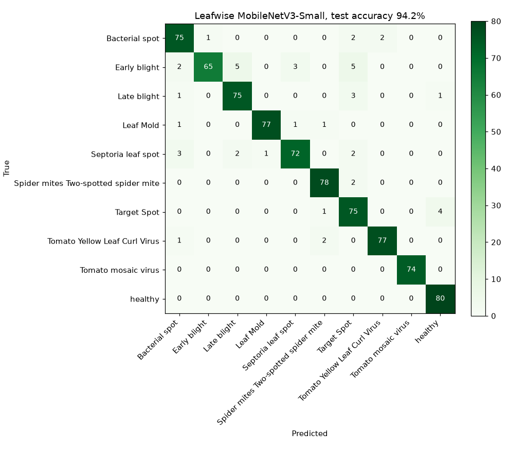

# Model card: leafwise-mnv3s

## Overview

| | |
|---|---|
| Task | Image classification of tomato leaf conditions (10 classes) |
| Architecture | MobileNetV3-Small, ImageNet-pretrained, fine-tuned (blocks 9+ and head) |
| Format | ONNX, opset 17, input `image` float32 `[N,3,224,224]`, output `logits [N,10]` |
| Size and latency | 6.1 MB; about 10 ms per image on one CPU core with ONNX Runtime |
| Code | `ml/train.py` (training, evaluation, export) and `ml/serve/server.py` (inference) |
| Author | Ignacio Peña, 2026. MIT licence for the code and weights |

## Intended use

Home gardeners take a photo of a single tomato leaf and get a first triage
(disease, pest or healthy) with recommended actions. It is not intended for
commercial crop decisions, other species or whole-plant photos.

## Training data

[PlantVillage](https://arxiv.org/abs/1511.08060) (Hughes & Salathé, 2015),
via the Hugging Face mirror `BrandonFors/Plant-Diseases-PlantVillage-Dataset`.

- **Classes:** Bacterial spot, Early blight, Late blight, Leaf mold, Septoria leaf spot, Spider mites (two-spotted), Target spot, Tomato yellow leaf curl virus, Tomato mosaic virus and Healthy.
- **Train and val:** a class-balanced random subset of the train split, 240 train and 40 validation images per class (seed 7).
- **Test:** up to 80 images per class from the separate test split. Mosaic virus has only 74.

**Augmentation:** random resized crop (scale 0.6–1), horizontal and vertical flips, rotation of ±20°, and colour jitter.

## Training

AdamW (lr 1e-3, wd 1e-4), cosine schedule, 12 epochs, batch size 32 and
label smoothing of 0.1. The checkpoint with the best validation accuracy is kept.
It takes about 5 minutes on an 8-core CPU.

## Evaluation

Test accuracy **94.2%**, macro-F1 **0.942** on 794 held-out images (2400 train / 400 val, 12 epochs).

| Class | Precision | Recall | F1 | Test images |
|---|---:|---:|---:|---:|
| Bacterial spot | 0.904 | 0.938 | 0.920 | 80 |
| Early blight | 0.985 | 0.812 | 0.890 | 80 |
| Late blight | 0.915 | 0.938 | 0.926 | 80 |
| Leaf Mold | 0.987 | 0.963 | 0.975 | 80 |
| Septoria leaf spot | 0.947 | 0.900 | 0.923 | 80 |
| Spider mites Two-spotted spider mite | 0.951 | 0.975 | 0.963 | 80 |
| Target Spot | 0.843 | 0.938 | 0.888 | 80 |
| Tomato Yellow Leaf Curl Virus | 0.975 | 0.963 | 0.969 | 80 |
| Tomato mosaic virus | 1.000 | 1.000 | 1.000 | 74 |
| healthy | 0.941 | 1.000 | 0.970 | 80 |

## Limitations and risks

- **Domain shift:** PlantVillage photos are single detached leaves on uniform backgrounds under controlled light. Expect lower accuracy on in-garden photos with clutter, shadows or several leaves. A field dataset such as PlantDoc would be the next step.
- **Closed set:** the model always predicts one of the 10 tomato classes. Leafwise flags non-tomato species and confidences below 60% in the summary, and can route those cases to a vision LLM second opinion.
- **Not a substitute for an agronomist:** viral diseases in particular should be confirmed before plants are destroyed.
- **Dataset licence:** the PlantVillage images keep their original terms. The `ml/samples` leaves are copies used only as regression fixtures; for each class, the fixture is the highest-confidence correct prediction among the first 30 test images.
